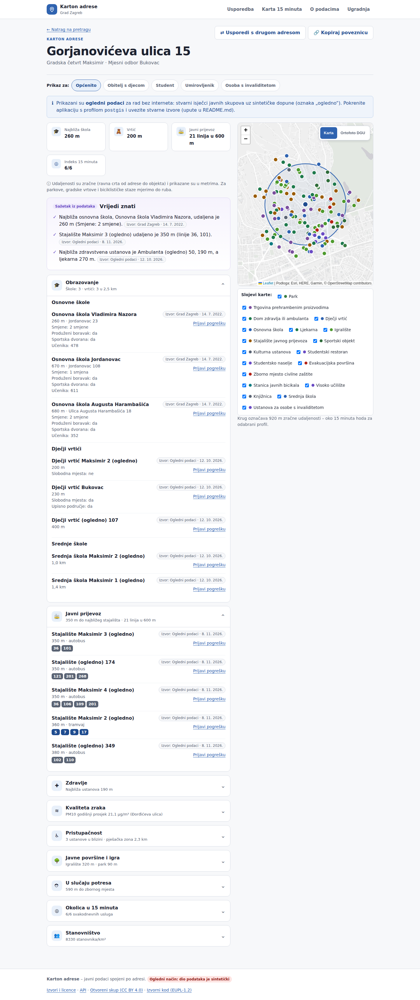
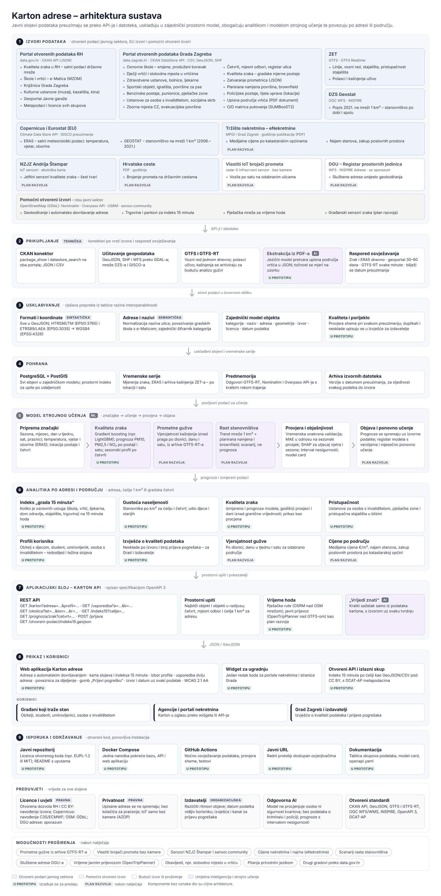

# Karton adrese

**Javni podaci spojeni po adresi.** Upišete zagrebačku adresu i dobijete pregled onoga što oglas za stan ne piše:
škole i vrtići, javni prijevoz, zdravstvo, kvaliteta zraka (s procjenom modela strojnog učenja), pristupačnost,
javne površine (igrališta, parkovi, sportski objekti, gradski vrtovi), zborna mjesta civilne zaštite, dostupnost
svakodnevnih usluga u 15 minuta hoda i gustoća stanovništva. Uz svaki podatak su navedeni izdavatelj i datum, a sve
udaljenosti su **zračne, u metrima** (za parkove, gradske vrtove i biciklističke staze mjeri se do ruba).

Karton se prilagođava profilu: **student** odabire svoj fakultet i interese (menza, knjižnica, bicikl, sport) i dobiva
udaljenost do fakulteta i linije ZET-a bez presjedanja; **obitelj s djecom** dobiva javne površine i „Moj indeks”;
**osoba s invaliditetom** odabire potrebe i vidi pristupačnost u četiri stanja (pristupačno, djelomično, nije, nema podatka).

Prijava na *Datathon Portala otvorenih podataka* (MPUDT, 2026.).



Snimke po profilima: [student](docs/snimke/10-karton-student.png) ·
[obitelj s djecom](docs/snimke/11-karton-obitelj.png) · [osoba s invaliditetom](docs/snimke/12-karton-osi.png) ·
[student na mobitelu](docs/snimke/10-karton-student-mobitel.png). Snimke se izrađuju automatski (workflow „Snimke zaslona”).

| Sloj | Tehnologija |
|---|---|
| Aplikacija | Java 21, Spring Boot 4.1 (Web MVC, JDBC, Flyway, Actuator), Thymeleaf |
| Pohrana | PostgreSQL 16 + PostGIS 3.4 (stvarni rad) ili H2 u memoriji (ogledni način) |
| Model | Python: LightGBM → ONNX; Java: ONNX Runtime |
| Karte i grafovi | Leaflet 1.9, Chart.js 4; podloga Esri ili ortofoto DGU 2024. (WMS) |
| API | REST + OpenAPI 3 (Swagger UI), otvoreni skup GeoJSON/CSV s DCAT-AP metapodacima |
| Isporuka | Docker Compose, GitHub Actions |

---

## Sadržaj

1. [Brzi početak (ogledni način, bez Dockera)](#1-brzi-početak-ogledni-način-bez-dockera)
2. [Rad sa stvarnim podacima (Docker Compose + PostGIS)](#2-rad-sa-stvarnim-podacima-docker-compose--postgis)
3. [Treniranje modela kvalitete zraka](#3-treniranje-modela-kvalitete-zraka)
4. [Konfiguracija i izvori podataka](#4-konfiguracija-i-izvori-podataka)
5. [API](#5-api)
6. [Arhitektura i struktura koda](#6-arhitektura-i-struktura-koda)
7. [Testovi i CI](#7-testovi-i-ci)
8. [Korisničko iskustvo i pristupačnost](#8-korisničko-iskustvo-i-pristupačnost)
9. [Otklanjanje poteškoća](#9-otklanjanje-poteškoća)
10. [Licence i navođenje izvora](#10-licence-i-navođenje-izvora)
11. [Što je provjereno, a što treba provjeriti](#11-što-je-provjereno-a-što-treba-provjeriti)

---

## 1. Brzi početak (ogledni način, bez Dockera)

U oglednom načinu aplikacija radi **bez interneta i bez baze**: koristi H2 bazu u memoriji, ogledne podatke i ogledni
ONNX model. Tako se brzo provjeri cijeli sustav. Vrtići, zdravstvo, trgovine i stajališta su sintetički (oznaka
„ogledno”), a osnovne škole, ljekarne, ustanove za osobe s invaliditetom, visoka učilišta, menze, studentska naselja,
biciklističke staze, javni bicikli, igrališta, sportski objekti, Odmorko i gradski vrtovi **stvarni su isječci** s
Portala otvorenih podataka Grada Zagreba, a parkovi i dječja igrališta iz OpenStreetMapa (preuzeto 8. 11. 2026.).

### Preduvjeti

| Alat | Verzija | Provjera |
|---|---|---|
| JDK (npr. [Eclipse Temurin](https://adoptium.net/)) | 21 ili noviji | `java -version` |
| Git | bilo koja | `git --version` |

Maven nije potrebno instalirati: repozitorij ima Maven Wrapper (`mvnw`, `mvnw.cmd`) koji ga sam preuzme.

### Pokretanje

**Windows (PowerShell):**
```powershell
git clone https://github.com/aradovanJava/karton-adrese.git
cd karton-adrese
.\mvnw.cmd spring-boot:run
```

**Linux / macOS:**
```bash
git clone https://github.com/aradovanJava/karton-adrese.git
cd karton-adrese
./mvnw spring-boot:run
```

Prvo pokretanje preuzima ovisnosti (nekoliko minuta). Kad se u zapisu pojavi `Started KartonAdreseApplication`,
otvorite **http://localhost:8080**.

| Stranica | Adresa |
|---|---|
| Početna (pretraga, profili) | http://localhost:8080/ |
| Karton adrese | http://localhost:8080/karton?adresa=Gorjanovićeva%20ulica%2015 |
| Usporedba | http://localhost:8080/usporedba |
| Karta grada 15 minuta | http://localhost:8080/karta |
| O podacima (izvori, kvaliteta, model) | http://localhost:8080/podaci |
| Ugradnja (widget) | http://localhost:8080/ugradnja |
| API dokumentacija (Swagger UI) | http://localhost:8080/swagger-ui.html |

Ogledne adrese: *Gorjanovićeva ulica 15, Ilica 1, Trg bana Josipa Jelačića 5, Savska cesta 41, Avenija Dubrovnik 15,
Maksimirska cesta 128*.

### Pokretanje u IntelliJ IDEA (Windows)

1. **File → Open** i odaberite mapu projekta (onu s `pom.xml`). IntelliJ sam učita Maven projekt i preuzme ovisnosti.
2. Ako IntelliJ ne odabere JDK 21 sam: **File → Project Structure → Project → SDK** → JDK 21 (npr. Amazon Corretto 21
   ili Eclipse Temurin 21; može se preuzeti iz istog izbornika, *Download JDK*).
3. Gore desno, u izborniku konfiguracija, nalaze se gotove konfiguracije iz mape `.run/`:

| Konfiguracija | Što radi |
|---|---|
| **Karton adrese (ogledni podaci)** | pokreće aplikaciju na http://localhost:8080 bez baze i interneta |
| Karton adrese (PostGIS) | isto, ali s profilom `postgis` (potreban PostgreSQL + PostGIS, vidi odjeljak 2) |
| Testovi (mvnw verify) | prevođenje i svi testovi |
| **Model 1 - priprema Pythona** | stvara `ml\.venv` (Python 3.11+) i instalira pakete – jednom, traje nekoliko minuta |
| **Model 2 - treniranje (ogledni podaci)** | trenira ogledni model, izvozi ONNX u `model\djordjiceva\` i pokreće Python testove |
| Model 3 - treniranje (stvarna mjerenja) | trenira na datotekama iz `ml\podaci\djordjiceva\` uz ERA5 s Open-Meteo arhive (odjeljak 3 b) |

Konfiguracije „Model” pozivaju PowerShell skripte iz `scripts\windows\` (`priprema-ml.ps1`, `treniraj-model.ps1`), pa
ih možete pokrenuti i bez IntelliJ-a, npr. `powershell -ExecutionPolicy Bypass -File scripts\windows\treniraj-model.ps1 -Ogledni`.
Nakon treniranja ponovno pokrenite aplikaciju da učita novi model.

### Profili, interesi i potrebe

Profil se bira gumbima na kartonu. Za studente i osobe s invaliditetom pojavljuje se obrazac s dodatnim odabirom.
Odabir se ne sprema – ostaje samo u poveznici, pa se karton može spremiti ili podijeliti:

| Primjer | Poveznica |
|---|---|
| Student, interesi menza i bicikl | `/karton?adresa=Gorjanovićeva ulica 15&profil=student&interes=menza&interes=bicikl` |
| Student s odabranim fakultetom | `…&profil=student&fakultet=<id iz /api/visoka-ucilista>` |
| Obitelj s djecom (javne površine, Moj indeks) | `/karton?adresa=Gorjanovićeva ulica 15&profil=obitelj` |
| Osoba s invaliditetom, kolica | `/karton?adresa=Gorjanovićeva ulica 15&profil=osi&potreba=kolica` |

Kako se računa:
- **Udaljenost** je zračna (ravna crta od adrese do objekta), prikazana u metrima („260 m”, iznad 1 km „1,2 km”).
  Za površine i linije (parkovi, gradski vrtovi, biciklističke staze) mjeri se do ruba; ako je adresa u parku, udaljenost je 0.
- **Indeks 15 minuta** koristi prag zračne udaljenosti koji odgovara 15 minuta hoda: brzina hoda profila × 15 ÷ faktor
  zaobilaženja 1,3 (≈ 920 m za opći profil, ≈ 635 m za osobu s invaliditetom).
- **Do mog fakulteta:** zračna udaljenost do odabranog visokog učilišta i linije ZET-a koje staju i na stajalištima do
  600 m od adrese i na stajalištima do 400 m od fakulteta (presjek linija iz ZET GTFS-a, bez presjedanja).
- **Pristupačnost** objekata dolazi iz OSM oznake `wheelchair`; ZET-ov GTFS ne sadrži polja `wheelchair_boarding` i
  `wheelchair_accessible` (provjereno 8. 11. 2026.), pa se pristupačnost stajališta prikazuje kao „nema podatka”.

### Izgradnja JAR-a

```bash
./mvnw clean package          # Windows: .\mvnw.cmd clean package
java -jar target/karton-adrese-1.0.0.jar
```

---

## 2. Rad sa stvarnim podacima (Docker Compose + PostGIS)

Profil `postgis` koristi PostgreSQL s PostGIS-om, preuzima stvarne skupove podataka (portali data.zagreb.hr i
data.gov.hr, ZET GTFS, DZS, OpenStreetMap) i geokodira adrese preko Nominatima.

### Preduvjeti

- [Docker Desktop](https://www.docker.com/products/docker-desktop/) (Windows/macOS) ili Docker Engine s Compose
  dodatkom (Linux). Provjera: `docker compose version`.

### Pokretanje

```bash
docker compose up -d --build
```

Pokreću se dva kontejnera: `baza` (PostGIS na portu 5432) i `aplikacija` (http://localhost:8080). Baza je na početku
prazna. Flyway pri prvom pokretanju stvara tablice i prostorne indekse, a izvori se odmah registriraju i vide na
stranici `/podaci` sa stanjem „NIJE_PREUZETO”.

### Uvoz podataka

Uvoz preuzima sve uključene izvore, usklađuje ih (koordinate, nazivi, duplikati, područje grada), sprema u PostGIS i
računa indeks grada 15 minuta za ćelije mreže 1 km².

```bash
docker compose run --rm aplikacija --uvoz=sve --zatvori
```

Za samo jedan izvor upišite njegov `id`, npr. `--uvoz=zet-gtfs`, a za više njih ih odvojite zarezom, npr. `--uvoz=zg-zborna-mjesta,zg-evakuacija,dzs-popis-2021`. Uvoz traje od nekoliko minuta do pola sata, ovisno o
broju adresa koje treba geokodirati: Nominatim dopušta najviše jedan zahtjev u sekundi.

Uvoz se može pokrenuti i dok aplikacija radi, preko administrativnog API-ja. Postavite token u datoteci `.env`
(pokraj `docker-compose.yml`):

```dotenv
KARTON_ADMIN_TOKEN=neki-dugi-tajni-niz
KARTON_USER_AGENT=karton-adrese/1.0 (kontakt: tim@primjer.hr)
```

Zatim pokrenite `docker compose up -d` i pozovite:

```bash
curl -X POST -H "X-Admin-Token: neki-dugi-tajni-niz" "http://localhost:8080/api/admin/uvoz?izvor=sve"
```

U profilu `postgis` podaci se automatski osvježavaju svakog ponedjeljka u 3:30 (`karton.uvoz.raspored`).

> **Nominatim i Overpass** (OpenStreetMap) traže prepoznatljiv `User-Agent` s kontaktom. Postavite
> `KARTON_USER_AGENT` sa svojom e-poštom ili adresom repozitorija. Nominatim se ne koristi za automatsko
> dovršavanje upisa (to zabranjuju pravila korištenja); prijedlozi dolaze iz lokalnog registra naziva ulica.

### Provjera s oglednim podacima u PostGIS-u (bez interneta)

```bash
KARTON_OGLEDNI=true docker compose up -d --build      # PowerShell: $env:KARTON_OGLEDNI="true"; docker compose up -d --build
```

### Bez Dockera, s vlastitim PostgreSQL-om

```sql
CREATE DATABASE karton;
CREATE USER karton WITH PASSWORD 'karton';
GRANT ALL PRIVILEGES ON DATABASE karton TO karton;
\c karton
CREATE EXTENSION postgis;          -- potrebna su administratorska prava
GRANT ALL ON SCHEMA public TO karton;
```

```bash
./mvnw spring-boot:run -Dspring-boot.run.profiles=postgis
# uvoz:
java -jar target/karton-adrese-1.0.0.jar --spring.profiles.active=postgis --uvoz=sve --zatvori
```

Varijable `DB_HOST`, `DB_PORT`, `DB_NAME`, `DB_USER` i `DB_PASSWORD` mijenjaju zadane postavke (localhost:5432/karton,
korisnik i lozinka `karton`).

---

## 3. Treniranje modela kvalitete zraka

Sekcija „Kvaliteta zraka” prikazuje **sezonsku procjenu mjesečnog prosjeka PM10** za najbližu mjernu postaju, s
rasponom nesigurnosti. Model se trenira u Pythonu (LightGBM) i izvozi u ONNX, a Java aplikacija ga izvodi preko
ONNX Runtimea. U repozitoriju je **ogledni model** (`model/djordjiceva/`) treniran na sintetičkim podacima, samo za
provjeru tehničkog toka. Prije prikaza građanima istrenirajte ga na stvarnim mjerenjima.

### Kako model radi

| Korak | Opis |
|---|---|
| Podaci | Dnevni prosjeci PM10 s postaje (dan vrijedi ako ima ≥ 18 satnih mjerenja) i dnevna meteorologija ERA5 |
| Značajke | kalendar (sin/cos dana u godini, mjesec, dan u tjednu, vikend, sezona grijanja) + temperatura, vlažnost, oborine, vjetar, visina graničnog sloja, tlak |
| Učenje | LightGBM regresija nad log(1 + PM10) |
| Provjera | vremenska unakrsna provjera u 5 dijelova; usporedba s osnovnim modelom (mjesečni prosjek); MAE, RMSE, R², pogađanje dana iznad 50 µg/m³ |
| Nesigurnost | 10. i 90. percentil omjera stvarnog i procijenjenog mjesečnog prosjeka izvan uzorka (≈ 80 % mjeseci) |
| Objašnjivost | prosječni apsolutni doprinos značajki (TreeSHAP iz LightGBM-a) |
| Izvoz | `pm10.onnx` + `metapodaci.json` (značajke, klimatologija, raspon, metrike, kontrolni primjer) + `kartica-modela.md` |
| Primjena | Java gradi „tipičnu godinu” iz klimatologije, izvodi ONNX model i uprosječuje po mjesecima |

Java i Python računaju značajke na isti način. Test `AplikacijaTest.onnxModelUJaviDajeIstiProfilKaoPython` provjerava
da Java s ONNX Runtimeom daje isti mjesečni profil kao Python, uz dopušteno odstupanje od 0,05 µg/m³.

### Priprema okruženja (Python 3.11+)

**Windows (PowerShell):**
```powershell
cd ml
py -3.12 -m venv .venv
.\.venv\Scripts\Activate.ps1
pip install -r requirements.txt
```

**Linux / macOS:**
```bash
cd ml
python3 -m venv .venv
source .venv/bin/activate
pip install -r requirements.txt
```

### a) Provjera cijelog toka na oglednim podacima

```bash
python -m karton_ml.treniranje --ogledni
python -m pytest -q
```

Rezultat se sprema u `../model/djordjiceva/`. Može i bez Pythona na računalu: `docker compose --profile ml run --rm ml`.

### b) Stvarni podaci

**1. Mjerenja PM10.** Preuzmite datoteke za odabranu postaju u `ml/podaci/<postaja>/`:
- **Portal otvorenih podataka Grada Zagreba**, skup „Kvaliteta zraka – gradske mjerne postaje”
  (https://data.zagreb.hr, pretraga „kvaliteta zraka”): mjesečne XLSX/CSV datoteke po postaji (licenca CC BY), ili
- **ISKZL** (Ministarstvo, https://iszz.azo.hr/iskzl/): izvoz satnih ili dnevnih podataka za postaju i onečišćujuću
  tvar PM10.

Učitavač sam prepoznaje stupac s datumom i stupac s PM10, decimalni zarez te satne ili dnevne vrijednosti. Ako
prepoznavanje ne uspije, zadajte stupce s `--stupac-datum "Datum"` i `--stupac-pm10 "PM10"`.

**2. Meteorologija ERA5.** Dvije mogućnosti:
- `--preuzmi-meteo`: preuzima ERA5 preko Open-Meteo arhive (bez ključa, za koordinate postaje i razdoblje mjerenja), ili
- Copernicus Climate Data Store: napravite besplatni račun, spremite ključ u `~/.cdsapirc`, instalirajte
  `pip install cdsapi xarray netCDF4`, preuzmite skup `reanalysis-era5-single-levels` (varijable `2m_temperature`,
  `2m_dewpoint_temperature`, `total_precipitation`, `10m_u_component_of_wind`, `10m_v_component_of_wind`,
  `boundary_layer_height`, `surface_pressure`) i predajte datoteku s `--meteo-netcdf era5.nc`.

**3. Treniranje:**
```bash
python -m karton_ml.treniranje \
  --pm10 "podaci/djordjiceva/*.xlsx" --preuzmi-meteo \
  --postaja-id djordjiceva --naziv "Đorđićeva ulica" \
  --mreza "Gradska mreža za praćenje kvalitete zraka" --lat 45.8131 --lon 15.9846
```

Skripta ispisuje MAE modela i osnovnog modela, provjerava da ONNX daje ista predviđanja kao LightGBM i sprema
rezultat u `model/<postaja-id>/`. Za više postaja ponovite naredbu s drugim `--postaja-id`, `--lat` i `--lon`. Karton
uvijek uzima najbližu postaju s modelom.

**4. Primjena u aplikaciji:** ponovno pokrenite aplikaciju. U Dockeru je mapa `./model` montirana u kontejner, pa je
dovoljno `docker compose restart aplikacija`. Na stranici `/podaci` vidjet ćete metrike novog modela, a oznaka
„ogledni model” nestaje.

---

## 4. Konfiguracija i izvori podataka

Sva se konfiguracija nalazi u `src/main/resources/application.yml`. Svaki izvor je jedan zapis u `karton.izvori`:

```yaml
- id: zg-ljekarne                       # oznaka (koristi se i za --uvoz=zg-ljekarne)
  naziv: Ljekarne Grada Zagreba
  izdavatelj: Grad Zagreb
  licenca: Otvorena dozvola
  vrsta: CKAN                           # CKAN | GEOJSON_URL | TABLICA_URL | OVERPASS | GTFS | POPIS_MREZA | WFS_POPIS | GRANICE | ULICE
  portal: https://data.zagreb.hr        # data.gov.hr: https://data.gov.hr/ckan
  paket: ljekarne-grada-zagreba         # identifikator skupa na portalu
  kategorija: LJEKARNA                  # zajednički šifrarnik kategorija
  # formati: [GEOJSON, CSV, XLSX]       # redoslijed željenih formata resursa
  # resurs: <id resursa>                # točno određeni resurs skupa
  # stupac-naziv / stupac-adresa / stupac-lat / stupac-lon: ručno mapiranje stupaca
  # omogucen: false
```

**Kako uvoz radi:** CKAN `package_show` vraća resurse skupa. Odabire se resurs po željenom formatu (među istim
formatom najnoviji) i preuzima. Stupci s nazivom, adresom i koordinatama prepoznaju se po imenu i rasponu vrijednosti
(WGS84, zamijenjeni redoslijed, HTRS96/TM, WKT). Objekti bez koordinata geokodiraju se po adresi, najviše 300 po
uvozu. Uvoz odbacuje objekte izvan područja grada i duplikate, a za svaki izvor bilježi izvješće: pročitano, spremljeno,
bez lokacije, geokodirano, izvan područja, datum podatka.

**Kategorije** (`Kategorija.java`): `SKOLA, VRTIC, LJEKARNA, ZDRAVSTVO, STAJALISTE, TRGOVINA` čine indeks grada 15
minuta. Ostale su `SREDNJA_SKOLA, KNJIZNICA, KULTURA, PARK, SPORT, IGRALISTE, ODMORKO, GRADSKI_VRT, VISOKO_UCILISTE,
MENZA, STUDENTSKI_DOM, BICIKLISTICKA_STAZA, JAVNI_BICIKL, PRISTUPACNOST, PJESACKA_ZONA, ZBORNO_MJESTO, EVAKUACIJA, GARAZA`.

**Linije i površine:** GeoJSON s geometrijom `LineString`/`MultiLineString` (biciklističke staze) ili
`Polygon`/`MultiPolygon` (gradski vrtovi) sprema se s cijelom geometrijom (stupac `geometrija`, migracija
`V2__geometrija.sql`). Parkovi iz OpenStreetMapa preuzimaju se s obrisom (`out geom`). Udaljenost se tada mjeri do ruba.

**Novi izvori (studenti, javne površine), provjereni sondom 8. 11. 2026.:**

| `id` | Skup na data.zagreb.hr | Format i geometrija | Zapisa |
|---|---|---|---|
| `zg-osnovne-skole` | Geoportal Osnovne škole (smjene, produženi boravak, dvorana) | GeoJSON, točke | 177 |
| `zg-visoka-ucilista` | Geoportal visokoškolske ustanove | GeoJSON, točke | 75 |
| `zg-studentski-restoran` | Geoportal Studentski restoran (osvježen 28. 10. 2026.) | GeoJSON, točke | 19 |
| `zg-studentsko-naselje` | Geoportal Studentsko naselje (osvježen 28. 10. 2026.) | GeoJSON, točke | 4 |
| `zg-biciklisticke-staze` | Geoportal biciklističke staze (podaci iz lipnja 2022.) | GeoJSON, MultiLineString | 2889 |
| `zg-javni-bicikli` | Geoportal Sustav javnih bicikala | GeoJSON, točke | 32 |
| `zg-igralista` | Geoportal javna sportska igrališta | GeoJSON, točke | 170 |
| `zg-sportski-objekti` | Geoportal Sportski objekti | GeoJSON, točke | 205 |
| `zg-odmorko` | Geoportal Odmorko (školska godina 2023./2024.) | GeoJSON, točke | 2 |
| `zg-gradski-vrtovi` | Geoportal gradski vrt | GeoJSON, MultiPolygon | 15 |
| `zg-knjiznice` | Knjižnice Grada Zagreba | XLSX (koordinate nisu provjerene – po potrebi geokodiranje) | – |
| `osm-igralista`, `osm-parkovi` | OpenStreetMap: dječja igrališta i parkovi s obrisom | Overpass | ≈ 860 / ≈ 100 |

**Sekcije „U slučaju potresa” i „Gustoća stanovništva” (provjereno sondom 9. 11. 2026.):**

| `id` | Skup | Što je bilo pogrešno | Rješenje |
|---|---|---|---|
| `zg-zborna-mjesta` | Zborna mjesta civilne zaštite Grada Zagreba (GeoJSON, 17 točaka, po jedna u četvrti) | naziv je u svojstvu `zboriste`, adrese nema, pa je uvoz odbacio sve zapise kao „bez naziva”; uz to je najbliže zborno mjesto često dalje od 2,5 km | `stupac-naziv: zboriste`; zborna mjesta i evakuacijske površine traže se u krugu od 6 km |
| `zg-evakuacija` | Evakuacijske površine Grada Zagreba (GeoJSON, 67 poligona, `NAZIV`, `Tip`) | – | udaljenost do ruba površine |
| `dzs-popis-2021` | Popis 2021. na mreži 1 km² | INSPIRE WFS DZS-a (`geostat.dzs.hr/inspire/pd-2021/wfs`) ima samo sloj `StatisticalDistribution`: jedan objekt za cijelu Hrvatsku, vrijednosti po ćelijama ugniježđene u svojstvu `value` (poslužitelj vraća najviše 100 ćelija × 12 kombinacija spola i dobi) i bez geometrije ćelija (samo poveznica na `su-grid-2021`) | isti podaci DZS-a iz Eurostatove „Census grid 2021” (V3, 30. 5. 2026.): iz ZIP-a od ≈ 570 MB HTTP rasponima se preuzima samo CSV (≈ 50 MB sažeto) i čitaju ćelije Zagreba (`GRD_ID`, `T`); bez interneta `url: classpath:popis/popis-2021-zagreb.csv.gz` |

Paketi „INSPIRE PD” po državama na GISCO-u (`HR_PD_3035_CSV.zip` i sl.) u trenutku provjere vraćali su HTTP 503.

Napomene iz provjere:
- **data.gov.hr** odbija veze s poslužitelja izvan Hrvatske (GitHub Actions dobiva „Connection reset”). Zato se
  knjižnice preuzimaju s data.zagreb.hr; ostali izvori s data.gov.hr rade iz Hrvatske.
- **ZET GTFS** nema polja o pristupačnosti (`wheelchair_boarding`, `wheelchair_accessible`).
- Skup „Geoportal pješačka zona” u trenutku provjere je vraćao HTTP 502 – uvoz će ga preuzeti kad bude dostupan.
- Ako neki skup nema GeoJSON ni CSV/XLSX resurs (npr. samo SHP), stranica `/podaci` prikazuje grešku s popisom
  dostupnih formata. Takav sloj pretvorite u GeoJSON (npr. QGIS-om) i dodajte ga kao `GEOJSON_URL`.

### Varijable okruženja

| Varijabla | Značenje | Zadano |
|---|---|---|
| `SPRING_PROFILES_ACTIVE` | `postgis` za stvarni rad | (ogledni način) |
| `DB_HOST`, `DB_PORT`, `DB_NAME`, `DB_USER`, `DB_PASSWORD` | PostgreSQL | localhost, 5432, karton, karton, karton |
| `KARTON_USER_AGENT` | User-Agent s kontaktom (Nominatim, Overpass) | karton-adrese/1.0 (+repozitorij) |
| `KARTON_ADMIN_TOKEN` | uključuje `/api/admin/*` | prazno = isključeno |
| `KARTON_OGLEDNIPODACI` | učitaj ogledne podatke u praznu bazu | `true` bez profila, `false` u `postgis` |
| `KARTON_MODEL_MAPA` | mapa s modelima | `model` |
| `PORT` | HTTP port | 8080 |

---

## 5. API

Interaktivna dokumentacija nalazi se na **/swagger-ui.html**, a specifikacija OpenAPI 3 na **/v3/api-docs**.

| Metoda i putanja | Opis |
|---|---|
| `GET /api/karton?adresa=…&profil=opcenito\|obitelj\|student\|umirovljenik\|osi` | cijeli karton adrese s izvorima i datumima |
| `GET /api/karton?…&profil=student&fakultet=<id>&interes=menza,bicikl` | karton s putem do fakulteta i interesima studenta |
| `GET /api/karton?…&profil=osi&potreba=kolica` | karton s potrebama osobe s invaliditetom |
| `GET /api/visoka-ucilista` | popis visokih učilišta (id, naziv, adresa, koordinate) za odabir fakulteta |
| `GET /api/usporedba?a=…&b=…` | usporedba dviju adresa po istim kriterijima |
| `GET /api/okolica?lat=…&lon=…&r=800&kategorije=SKOLA,VRTIC` | objekti u polumjeru (PostGIS `ST_DWithin`) |
| `GET /api/indeks15[?celija=CRS3035RES1000mN…E…]` | indeks grada 15 minuta po ćeliji |
| `GET /api/prognoza/zrak?postaja=…` ili `?lat=…&lon=…` | sezonska procjena PM10 (ONNX model) |
| `GET /api/adrese?q=gorj` | prijedlozi adresa (lokalni registar) |
| `GET /api/kvaliteta-podataka` | izvješće o kvaliteti svakog izvora |
| `POST /api/prijava` | prijava pogreške u podacima (JSON: `objekt`, `izvor`, `adresa`, `opis`, `email`) |
| `GET /api/otvoreni-podaci/indeks15.geojson` / `.csv` | **izlazni otvoreni skup** (CC BY 4.0) |
| `GET /api/otvoreni-podaci/dcat.jsonld` | DCAT-AP metapodaci za objavu na Portalu otvorenih podataka |
| `POST /api/admin/uvoz?izvor=sve` | pokretanje uvoza (zaglavlje `X-Admin-Token`) |
| `GET /api/admin/prijave` | prijave pogrešaka za prosljeđivanje izdavateljima |

```bash
curl "http://localhost:8080/api/karton?adresa=Gorjanovi%C4%87eva%20ulica%2015&profil=obitelj"
```

---

## 6. Arhitektura i struktura koda



| Sloj arhitekture | Paket / mapa |
|---|---|
| 1 Izvori | `application.yml` → `karton.izvori` |
| 2 Prikupljanje | `uvoz` (CKAN, Overpass, GTFS, popis 2021. na mreži 1 km², granice, ulice; raspored osvježavanja) |
| 3 Usklađivanje | `core.uvoz` (prepoznavanje stupaca, GeoJSON), `core.geo` (HTRS96/TM, EPSG:3035), `core.tablica` |
| 4 Pohrana | `baza` (JDBC), `db/migration/postgresql` (PostGIS) i `db/migration/h2` |
| 5 Model | `ml/` (Python), `model/` (ONNX), `ml.ModelZraka` i `core.ml` (Java) |
| 6 Analitika | `analitika` (karton, usporedba, indeks 15 minuta, sažetak), `core.analitika` |
| 7 Karton API | `api` (REST, OpenAPI, otvoreni podaci, administracija) |
| 8 Prikaz | `web` + `templates/` (Thymeleaf), `static/` (CSS, Leaflet, Chart.js) |
| 9 Isporuka | `Dockerfile`, `docker-compose.yml`, `.github/workflows/` |

Paket `core` nema ovisnosti o Springu: projekcije, JSON, CSV, GTFS i izračuni mogu se testirati i ponovno koristiti
samostalno. Prostorni upit ima dvije izvedbe: `PostgisPretraga` (profil `postgis`, `ST_DWithin` nad GiST indeksom)
i `PravokutnaPretraga` (H2, pravokutni predfiltar i haversine).

```
karton-adrese/
├── src/main/java/hr/kartonadrese/
│   ├── core/           jezgra bez ovisnosti (geo, json, tablica, uvoz, gtfs, analitika, ml, model, http)
│   ├── config/         konfiguracija (KartonSvojstva, izvori)
│   ├── baza/           repozitoriji (JdbcClient) i prostorna pretraga
│   ├── uvoz/           prikupljanje i usklađivanje, ogledni podaci, pokretanje iz naredbenog retka
│   ├── geokod/         geokodiranje (predmemorija + Nominatim)
│   ├── analitika/      karton, sažetak, usporedba, indeks 15 minuta
│   ├── ml/             ONNX Runtime
│   ├── api/            REST API
│   └── web/            Thymeleaf kontroleri
├── src/main/resources/ application.yml, templates/, static/, db/migration/, ogledni/podaci.json
├── ml/                 Python: učitavanje podataka, značajke, treniranje, testovi
├── model/              ONNX model, metapodaci, kartica modela
├── scripts/            ogledni_podaci.py, snimke.py
└── docs/               arhitektura, snimke zaslona
```

---

## 7. Testovi i CI

```bash
./mvnw verify                      # Java: jezgra + cijela aplikacija (MockMvc) + ONNX model
cd ml && python -m pytest -q       # Python: značajke, učitavanje, cijeli tok treniranja
```

GitHub Actions (`.github/workflows/ci.yml`) za svaki push i pull request pokreće tri posla:
1. **Java**: `mvn verify` (projekcije uspoređene s pyproj-om, uvoz CSV/GeoJSON/GTFS, geometrija linija i površina
   (udaljenost do ruba), prikaz u metrima, interesi i potrebe, indeks 15 minuta, API, stranice za sve profile,
   otvoreni skup, prijava pogreške, usporedba ONNX modela s Pythonom),
2. **ML**: pytest i treniranje s ONNX izvozom,
3. **Docker**: `docker compose up` s PostGIS-om i oglednim podacima, zatim provjera API-ja nad pravom bazom.

Workflow `snimke.yml` pokreće aplikaciju i Playwrightom snima glavne stranice (artefakt „snimke-zaslona”). Lokalno:
`pip install playwright && playwright install chromium && python scripts/snimke.py`.

Workflow `sonda.yml` (**Sonda izvora**) provjerava skupove na portalima i ZET GTFS iz oblaka: ispisuje metapodatke,
stupce i primjere zapisa te pakira preuzete datoteke u zapis posla. Iz tih datoteka skripta
`scripts/ogledni_stvarni.py` dopunjuje ogledne podatke stvarnim isječcima:

```bash
python scripts/sonda.py                                   # preuzima u mapu sonda-izlaz/
python scripts/ogledni_stvarni.py sonda-izlaz [osm-parkovi-igralista.json]
```

---

## 8. Korisničko iskustvo i pristupačnost

Sučelje prati Nielsenovih 10 heuristika i WCAG 2.1 AA:

| Heuristika | U aplikaciji |
|---|---|
| Vidljivost stanja sustava | izvor i datum uz svaki podatak; potvrda nakon prijave; stanje uvoza na `/podaci` |
| Podudarnost sa stvarnim svijetom | udaljenosti u metrima (zračno, jasno označeno); nazivi kategorija na hrvatskom; brzina hoda prema profilu za indeks 15 minuta |
| Kontrola i sloboda | „Natrag na pretragu”, poveznica za dijeljenje, zatvaranje dijaloga tipkom Esc, slojevi karte |
| Dosljednost | isti dizajnerski tokeni na svim stranicama i u Figma prototipu |
| Sprječavanje pogrešaka | prijedlozi adresa, provjera iste adrese u usporedbi, provjera obrasca |
| Prepoznavanje umjesto prisjećanja | primjeri adresa, profili kao gumbi, ista podloga na svim kartama |
| Fleksibilnost | profili korisnika, interesi studenta i potrebe osoba s invaliditetom (u poveznici, bez spremanja), API i widget |
| Estetika i minimalizam | sažetak na vrhu, detalji u sekcijama koje se otvaraju |
| Oporavak od pogrešaka | „Adresu nismo pronašli” s prijedlozima; poruka kad podloga karte nije dostupna |
| Pomoć i dokumentacija | „Kako računamo?”, stranica O podacima, kartica modela, Swagger |

Ostalo: semantički HTML (`details`/`summary`, `dialog`, `fieldset`), poveznica „Preskoči na sadržaj”, vidljiv fokus,
mete od najmanje 44 px, tablična alternativa grafu, prilagodba za 375 px i poštovanje `prefers-reduced-motion`.

---

## 9. Otklanjanje poteškoća

| Problem | Rješenje |
|---|---|
| `JAVA_HOME is not set` / `java` nije pronađen | Instalirajte JDK 21 i postavite `JAVA_HOME` (Windows: *Postavke sustava → Varijable okruženja*). |
| Port 8080 je zauzet | `./mvnw spring-boot:run -Dspring-boot.run.arguments=--server.port=8081` |
| `mvnw` nema prava izvođenja (Linux/macOS) | `chmod +x mvnw` |
| PowerShell ne dopušta `Activate.ps1` | `Set-ExecutionPolicy -Scope CurrentUser RemoteSigned` |
| Docker na Apple Silicon (M1/M2/M3) | slika `postgis/postgis` je za amd64; Docker Desktop je pokreće emulacijom (sporije, ali radi). |
| ONNX model se ne učitava | U zapisu potražite „ONNX model … nije učitan”. ONNX Runtime ne radi na Alpine Linuxu (musl); koristite sliku temeljenu na glibc-u (kao u `Dockerfile`). Aplikacija radi i bez modela, ali bez procjene. |
| Uvoz izvora javlja HTTP 404 | Identifikator skupa na portalu se promijenio. Pronađite novi na data.zagreb.hr ili data.gov.hr i ispravite `paket`. |
| „Ne prepoznajem stupce” ili 0 spremljenih zapisa | Na `/podaci` pogledajte opis mapiranja stupaca i postavite `stupac-naziv`, `stupac-lat` i `stupac-lon`. |
| Nominatim vraća 403 | Postavite `KARTON_USER_AGENT` s kontaktom i ne smanjujte razmak između zahtjeva. |
| Iza tvrtkinog proxyja | `java -Dhttps.proxyHost=… -Dhttps.proxyPort=… -jar …` (aplikacija koristi sistemski proxy). |
| Karta je siva | Podloga (Esri ili DGU) nije dostupna; podaci i dalje rade. Probajte drugu podlogu prekidačem na karti. |

---

## 10. Licence i navođenje izvora

- **Izvorni kod:** EUPL-1.2 (`LICENSE`). Uključene biblioteke: Leaflet (BSD-2), Chart.js (MIT).
- **Izlazni skup** indeksa grada 15 minuta: **CC BY 4.0**. Navesti: *Karton adrese, na temelju otvorenih podataka
  Grada Zagreba, ZET-a i DZS-a te OpenStreetMapa*.
- **Ulazni podaci:** Grad Zagreb i Portal otvorenih podataka RH (Otvorena dozvola ili CC BY 4.0, kako navodi
  izdavatelj); ZET (GTFS); DZS i Eurostat (Popis 2021. na mreži 1 km², „Census grid 2021”); Copernicus ERA5 („Contains modified Copernicus Climate Change Service
  information”); © suradnici OpenStreetMapa (ODbL); podloga Esri ili Digitalni ortofoto DGU 2024. (Otvorena dozvola).
- Aplikacija ne prikuplja osobne podatke. Upisane adrese se ne spremaju uz korisnika, kolačići za praćenje se ne
  koriste, a e-pošta u prijavi pogreške nije obavezna.

---

## 11. Što je provjereno, a što treba provjeriti

**Provjereno sondom izvora** (`scripts/sonda.py`, GitHub Actions, 8. 11. 2026.): struktura, formati i broj zapisa
novih skupova s data.zagreb.hr (tablica u odjeljku 4), ZET GTFS bez polja o pristupačnosti, parkovi i dječja igrališta
iz OpenStreetMapa.

**Provjereno** (lokalno i u GitHub Actionsu):
- prevođenje i svi testovi (Java 21, Spring Boot 4.1, H2), uključujući učitavanje ONNX modela u Javi i jednak
  rezultat kao u Pythonu,
- pokretanje s PostgreSQL/PostGIS-om u Docker Composeu, Flyway migracije, prostorni upiti i karton nad PostGIS-om,
- Python: učitavanje, značajke, treniranje, ONNX izvoz i provjera,
- projekcije EPSG:3035 i HTRS96/TM (podudaraju se s pyproj-om na milimetar).

**Treba provjeriti sa stvarnim izvorima** (iz razvojnog okruženja nisu bili dohvatljivi):
- identifikatore skupova i strukturu stupaca na data.zagreb.hr i data.gov.hr (prepoznavanje stupaca je automatsko, ali
  svaki skup treba jednom pregledati na `/podaci`),
- adresu ZET GTFS datoteke i sučelje ISKZL za preuzimanje mjerenja (označeno kao eksperimentalno u
  `ml/karton_ml/podaci.py`),
- Open-Meteo ERA5 preuzimanje (`--preuzmi-meteo`); zamjena je izravno preuzimanje iz Copernicus CDS-a.
